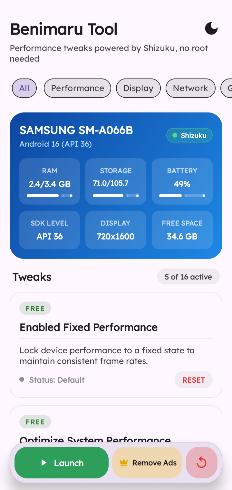
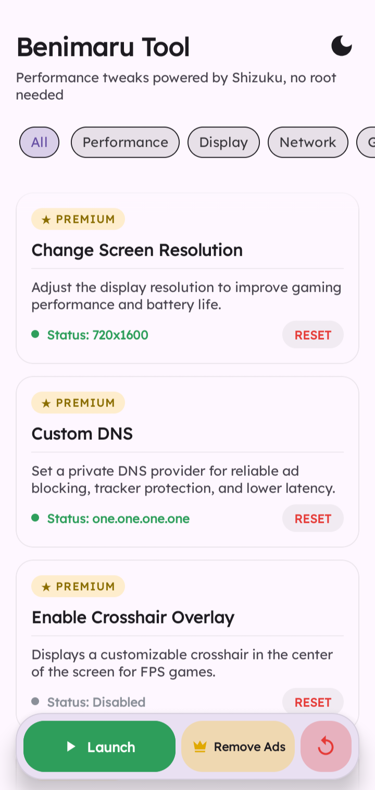
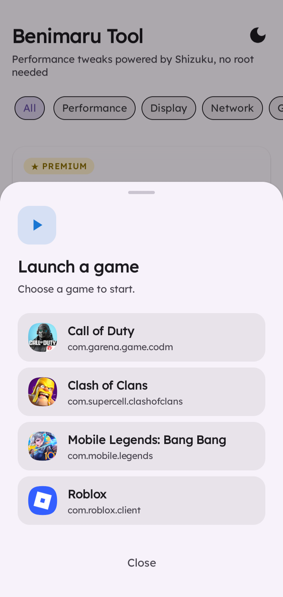

#  PROJECT ZENITH 

### Take control of your Android experience.

**A rootless Android toolkit for performance tuning, gaming controls, display adjustments, and practical system utilities.**

---

## Meet Project Zenith

**Project Zenith** brings useful Android controls into one focused workspace. Built for users who want more say over how their device behaves, Zenith uses the [Shizuku](https://shizuku.rikka.app/) service to run supported ADB shell operations without requiring root access.

Tune selected performance settings, adjust display behavior, access gaming utilities, and manage supported system options directly from your phone. After Shizuku is configured, many tools can be used without connecting to a computer.

> **Designed for control, built with safeguards.** Available operations depend on your Android version, device manufacturer, and system permissions. No tweak can guarantee higher FPS, lower latency, or improved battery life on every device.

---

## What Zenith brings together

### 🎮 Gaming and responsiveness

| Tool | What it does |
|:--|:--|
| **Performance Mode** | Applies the supported fixed-performance setting to help keep performance behavior more consistent during demanding workloads. |
| **Android Game Mode** | On supported Android 12+ devices, accesses the native Game Mode controls exposed by the system. Results depend on the device and its implementation. |
| **Touch Response Controls** | Adjusts supported touch-related settings, including long-press behavior and available sampling-rate controls. Hardware limits still apply. |
| **Game Library and Launch Tools** | Finds installed games for convenient launching and can request supported DEX speed-profile compilation to help reduce some startup or runtime overhead. |
| **Aim Reference Overlay** | Places a configurable crosshair at the center of the screen for supported use cases. |
| **Tap and Swipe Automation** | Provides a movable floating control for repeating taps, swipes, or combined actions at a chosen interval, position, and swipe distance. It does not require Accessibility permission. |

### 🖥️ Display and interface

| Tool | What it does |
|:--|:--|
| **Refresh Rate Controls** | Sets supported minimum and maximum display refresh-rate values. Actual refresh behavior remains subject to device capabilities and system policy. |
| **Resolution Manager** | Changes the supported display resolution and calculates an aspect ratio. A short automatic revert countdown helps recover if the selected resolution causes display problems. |
| **Reduced Animation Scale** | Lowers system animation scales to make navigation feel quicker. |
| **Window Blur Control** | On supported Android 12+ devices, disables system window blur effects where the setting is available. |
| **Light and Dark Appearance** | Switches between light and dark interface themes, with cards designed to remain readable in either mode. |

### 🧰 Device tools and system controls

| Tool | What it does |
|:--|:--|
| **Live Device HUD** | Displays supported live readings such as CPU frequency, temperature, memory use, battery temperature, and refresh rate in a movable overlay. Available readings vary by device. |
| **Storage Trim** | Requests the system's supported storage-trim operation to help the storage controller manage blocks that are no longer in use. It is not a guaranteed instant speed boost. |
| **Network Settings** | Applies the network-related adjustments available to the app. Results depend on Android, the network, and the selected configuration; lower ping is not guaranteed. |
| **Private DNS Selector** | Lets you choose a supported Private DNS provider, such as Cloudflare, Quad9, or Control D, through Android's settings interface. Provider behavior and filtering depend on the service you select. |
| **Background Resource Controls** | Offers supported options for reducing background activity and prioritizing the app you are using. Android may restrict what can be changed. |
| **Gaming Focus** | Suppresses supported heads-up notification interruptions during gameplay. |
| **Developer Options Toggle** | Provides a shortcut to switch Developer Options off when supported. This does not guarantee that banking apps or games will stop flagging a device or configuration. |

### 🔐 Built for everyday use

| Capability | What it means |
|:--|:--|
| **APK Integrity Check** | Uses SHA-256 signature verification to help detect modified or unofficial application packages before supported actions proceed. |
| **Release Checker and Updater** | Checks the configured official GitHub release source and offers an in-app update flow. |
| **Restore Defaults** | Provides a single place to reset supported tweaks to their default values. Review the reset behavior before relying on it to reverse every device-specific change. |

---

## Preview

<table align="center">
  <tr>
    <th align="center">Zenith Home</th>
    <th align="center">System Controls</th>
    <th align="center">Device Monitor</th>
  </tr>
  <tr>
    <td align="center"></td>
    <td align="center"></td>
    <td align="center"></td>
  </tr>
</table>

*The current image filenames retain their original names. They can be renamed separately if you want the repository assets to match the new branding.*

---

## Before you start

Project Zenith relies on **Shizuku** for operations that need elevated ADB-shell privileges. It does not require root, but it does require Shizuku to be installed, started, and authorized.

1. **Install Shizuku.** Use the official [Shizuku project](https://github.com/RikkaApps/Shizuku) or its [setup guide](https://shizuku.rikka.app/guide/setup/).
2. **Start the service.** On Android 11 and newer, Wireless debugging is a common setup method. A computer and ADB can also be used where appropriate.
3. **Authorize Zenith.** Open Project Zenith and approve its Shizuku access request.
4. **Allow overlays when needed.** The floating monitor, crosshair, and automation controls need the Android “Display over other apps” permission.
5. **Check compatibility.** Some controls are available only on particular Android versions or device implementations.

Grant only the permissions required for the tools you intend to use.

---

## Install Project Zenith

1. Open the project's [Releases](../../releases) page.
2. Download the latest available Zenith APK.
3. Install the APK on your Android device. If Android asks, allow installation from the source you used.
4. Make sure Shizuku is running.
5. Launch Project Zenith and approve the Shizuku permission prompt.
6. Grant overlay permission if you plan to use floating tools.
7. Review each setting before applying it.

**Download only builds from a source you trust.** If an installation or update fails, check the release notes and your device's Android version before trying again.

---

## Technology

| Component | Role |
|:--|:--|
| [Kotlin](https://kotlinlang.org/) | Native Android application development. |
| [Material Design 3](https://m3.material.io/) | Interface components and adaptable visual styling. |
| [Kotlin Coroutines](https://kotlinlang.org/docs/coroutines-overview.html) | Runs supported background work without blocking the interface. |
| [Shizuku API](https://github.com/RikkaApps/Shizuku-API) | Enables authorized ADB-shell operations without root. |
| [Toasty](https://github.com/GrenderG/Toasty) | Styled feedback messages for supported actions. |

---

## Safety notes

Project Zenith changes Android settings and can expose device-specific limitations. **Use every control at your own discretion.**

- Unsupported refresh rates or display resolutions may cause visual glitches or temporarily make the screen difficult to use. The resolution revert countdown is a safeguard, not a guarantee.
- Disabling or attempting to bypass thermal protections can lead to overheating, instability, reduced hardware lifespan, or unexpected shutdowns. Do not use settings that compromise your device's thermal safety.
- Performance, touch response, network behavior, and battery life vary by hardware, firmware, workload, and environment. Improvements are not guaranteed.
- Automated taps and swipes may violate the rules of some games or services. Use automation only where permitted; account penalties may apply.
- Turning off Developer Options does not guarantee that an application will accept the device or bypass its security checks.
- Reset tools can only restore the settings they are designed to manage. Check important changes manually if your device behaves unexpectedly.

The project is provided **“as is,” without warranty**, subject to the terms of the MIT License. The maintainers are not responsible for damage, data loss, account penalties, or other consequences resulting from use.

---

## License

Project Zenith is distributed under the **MIT License**. See [LICENSE](LICENSE) for the full terms.

---

### Built for control. Tuned for your device.

If Project Zenith is useful to you, consider starring the repository, reporting reproducible issues, and contributing improvements.

**Project Zenith — make your Android setup work your way.**

